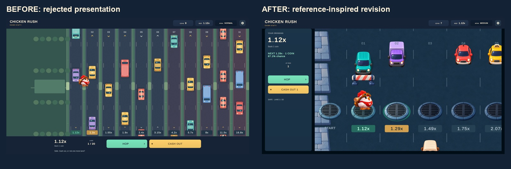
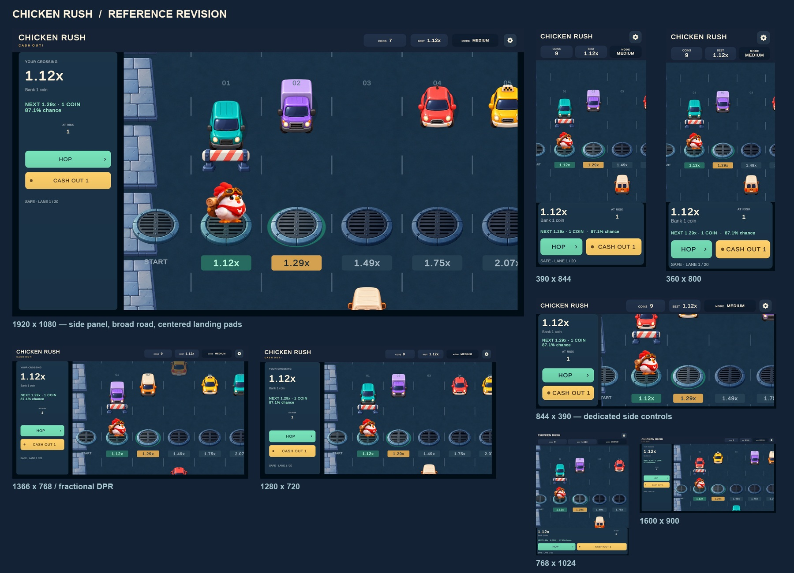

# Chicken Rush 3.0 — implementation and testing report

Status: ready for client visual review, with physical-device/browser-release
coverage outstanding. Existing Unity project modified; no replacement project.

## Reference comparison

The supplied [video](https://www.youtube.com/watch?v=KQrMVcBXHFw) was accessible
through the browser. Representative gameplay views were inspected and captured
in the working session at 0:29,0:58 and1:56, with the opening at0:00. This was
sampled inspection, not a claim to have watched all 4:51. The
[official reference description](https://stake.com/casino/games/chicken) was
also inspected. No reference artwork or branding is included in the game.

The local 18.63-second Classic Crossy Roads.mp4 is a recording of the rejected
previous build. Six baseline frames are under Reference/; it is not mislabeled
as original Stake gameplay. Browser-session reference captures were not bundled
as a downloaded video. Exact visual fidelity is not claimed.

| Comparison | Previous implementation | Corrective result |
|---|---|---|
| Road | Thin repetitive green strips | Broad continuous quiet dark asphalt, sparse markings |
| Safe position | Divider strip | Raised oval pad on each lane center; protective barrier |
| Scale | Tiny chicken / decorative flat cars | Prominent original chicken and larger dimensional vehicles |
| View | Flat top-down vehicle symbols | Restrained raised front/rear views without dramatic isometric rotation |
| Multipliers | Small labels at screen edge | Large badges immediately beneath pads; next pad highlighted |
| Desktop controls | Wide bottom dock | Large multiplier and stacked actions in a side panel |
| Core risk | Timed traffic avoidance | Seeded per-hop outcomes, explicit chance and potential coin reward |

## Implemented gameplay and presentation

Easy/Medium/Hard/Hardcore have configurable survival arrays, increasing rewards,
and 24/20/16/12 lanes. Default hop time is 0.62s. One accepted input commits one
outcome; input timing and cosmetic traffic never consume randomness. SeededRisk
uses a reproducible counter hash, not a certified or cryptographic fairness
service. No real-money mechanism, account system, purchase or withdrawal exists.

RoundRules remains currency/state authority. No duplicate stake deduction,
lane skip, mid-hop cash-out, duplicate payout or contradictory Land/Hit callback
is accepted. The current multiplier, next multiplier, next payout, success chance,
selected risk and secured result are visible. Integer coin rewards round down
consistently. Defaults use cumulative survival to construct the reward table;
tests verify that relationship. No exact RTP is advertised.

Traffic visibly stages each crossing. A losing vehicle makes swept geometric
contact before Hit; successful traffic brakes behind protection or passes clear.
Near-miss effects require positive measured body clearance. Cleared lanes gain
barriers; opposing lanes use separate front/rear artwork. Twelve recycled road
segments and 36 cars extend the visible course without growing their pools.

The original 54 chicken PNGs are byte-identical to the rollback source. Idle,
Walk, Hop, Hit and Celebrate remain; Danger adds a subtle lean using existing
idle drawings. Hit and Celebrate hold until reset. Anticipation, flight, landing,
collision effects, reward feedback, passing audio and a low progress pulse are
connected to the actual state. No new hand-drawn danger sequence is claimed.

## Original art and rendering

Ten original shaded vehicle sprites cover compact/taxi/van/truck/delivery in
both directions. New grates, barriers, foliage, paving and quiet painted asphalt
share rounded forms, upper-left highlights and restrained shadows. The coarse
first asphalt pass and barrier-over-vehicle composition were rejected and fixed
after actual-player visual review.

Native cutouts retain proportions and resolution. Low-alpha noise below 24/255
was removed during inspected extraction; 8px fully transparent borders are
verified. Exact cuts and prompts are in SourceArt/ReferenceRevision/. Final
assets are under Assets/ChickenRush/Art/Arcade/. The chicken remains a roughly
130–140px native silhouette; scaling does not create additional detail. Small
pose differences from the supplied sheet remain. This is a client-review build,
not a claim of a hand-authored production animation master.

UI retains lossless RGBA32 atlas sources and9-slice card borders. World atlases
use ETC2 RGBA, bilinear filtering, no mipmaps, padded packing and no rotation.
The existing URP unlit path, no HDR/post-processing/shadows, pooled particles,
single-thread WebAssembly,64MiB initial heap and512MiB maximum remain. DPR is
capped at 2. Gzip fallback works on ordinary static hosting.

## Validation

Unity 6000.3.10f1: **46 tests passed**, no skipped or failed tests. EditMode
tests include seed frequency/reproducibility, chance/reward math, rule guards,
next-reward rounding, physical winning/losing traffic choreography across all
four modes and configured lanes, pool reuse, geometry, source pivots and actual
nine-slice mesh corners. Four PlayMode tests exercise the real Animator,
including Danger→Hop and terminal interruption guards.

Final WebGL build: **Succeeded**, 0 errors,
0 warnings, 16,783,390 bytes reported by Unity,
173.21s. BuildInputs.json hashes all Assets/Packages/ProjectSettings
inputs before compilation; report generation verifies they still match.
BuildArtifacts.json hashes the delivered files; gzip/WASM magic and ZIP integrity
are audited by the packaging step. No unrelated project was changed.

Browser: **Chrome 156.0.8078.79**, Windows headless, normal browser autoplay policy.
All inputs are real mouse/key/touch-emulation events. No seed/result/currency
is injected. Opt-in read-only QA telemetry exposes public chances and current
state, not future outcomes.

| Viewport | Layout | DPR | Input | Result | Sparse Unity delta estimate | Browser callback Hz |
|---|---|---|---|---|---|---|
| 1920×1080 | Desktop | 1 | Mouse / keys | Passed | 58.8 | 96.2 |
| 1600×900 | Desktop | 1 | Mouse / keys | Passed | 58.8 | 118.3 |
| 1366×768 | Desktop | 1.25 | Mouse / keys | Passed | 58.8 | 120.0 |
| 1280×720 | Desktop | 1 | Mouse / keys | Passed | 58.8 | 120 |
| 390×844 | Portrait | 2 | Touch emulation | Passed | 58.8 | 120 |
| 360×800 | Portrait | 2 | Touch emulation | Passed | 58.8 | 119.4 |
| 844×390 | Landscape | 2 | Touch emulation | Passed | 58.8 | 118.9 |
| 768×1024 | Tablet | 2 | Touch emulation | Passed | 83.3 | 85.2 |

All cases verify full viewport/no scroll, no clipped/ellipsized UI text, separate
gameplay/control regions, >=44px main targets, both traffic directions, one hop
per input, cash-out blocking during a hop, no duplicate payout, win/lose states,
pause/resume, replay and persisted-balance reload. Desktop reaches lane13 and
checks all four difficulty choices. Portrait390×844 rotates live to844×390 and
back without changing the round or balance. A label reformatting bug found in
that test was corrected and retested.

The median of per-case sparse Unity delta estimates is 58.8. Those reciprocal
delta-time samples are not a sustained rendered-FPS measurement. Browser callback
cadence is sampled independently over 1.8 seconds per case. Both are indicative
workstation observations, not a physical-device GPU performance certification.
WASM heap readings, when exposed by the player, are recorded in BrowserQA.json;
they are not total browser-process memory. Target is60 rendered FPS on capable
devices with appropriate authored sprite timings, not60 unique drawings/sec.

## Remaining limits

Physical iOS/Android, Safari/Firefox, hardware-notch handling and phone audio
output have not been separately tested. Emulated touch and safe-area-aware code
do not replace those checks. The camera composition is compared with sampled
reference views; original artwork/UI styling and the disclosed virtual risk
tables intentionally remain this project's own implementation.

## Delivery and reproduction

- Existing updated source: D:/30 games/Classic Crossy Roads
- Player: Builds/WebGL/; archive: Builds/ChickenRush-WebGL.zip
- Source archive: Builds/ChickenRush-UnitySource.zip
- Run: python Tools/serve.py → http://127.0.0.1:8783/
- Validate/build: python Tools/reference_build.py
- Browser QA: python Tools/reference_qa.py
- Package/report: python Tools/package_build.py; python Tools/write_reference_report.py
- Rollback: Backups/PreReferenceRevision/Source.zip and ChickenRush-v2-WebGL.zip

Diagnostics from the initial visual/rotation pass are retained separately;
current screenshots and BrowserQA.json refer to the final compiled player.
